# Overbar

> **Making a mod, hack, port or other derivative work from this repo? You must credit me (abdulahmad) and everyone credited in this repo, clearly, in your own repo and in every release. See [Credits and derivative works](#credits-and-derivative-works).**

**A ready-made settings menu, scaler and CRT look pack for native ports of retro games.**

Overbar is a derivative of [1nputs' PulseMan](https://github.com/1nputs/pulseman). It's what the NHL '94 Genesis and SNES C ports and the NHL 94, 95 and 96 PC ports use for their in-game menu, their picture and their CRT looks.

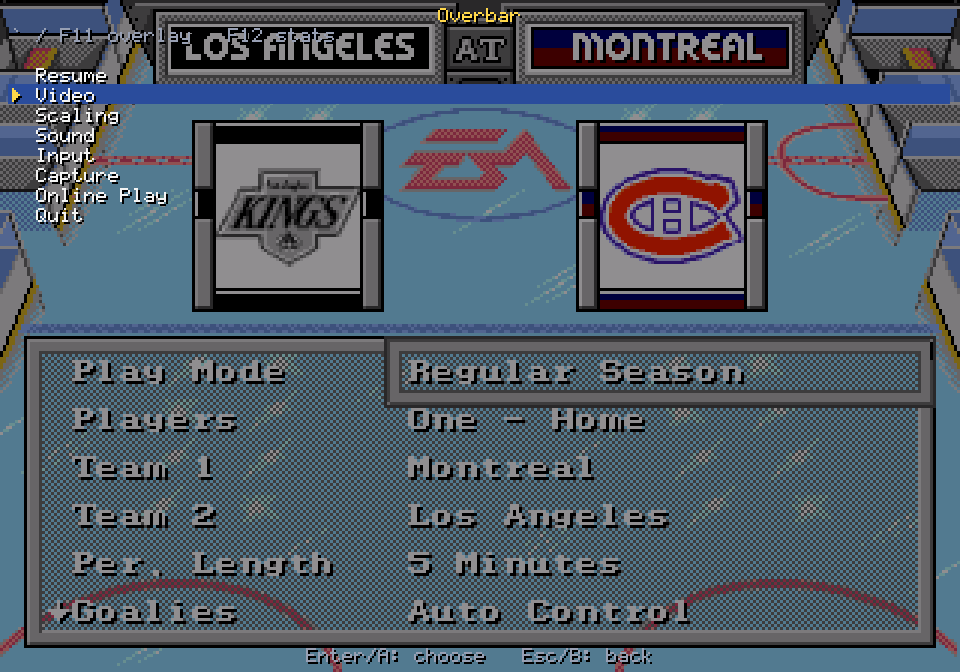

---

## ✨ For players: what you get

### 🎮 One menu, always one key away

- Press **`` ` ``** (the key above Tab) or **F11** to open the menu over the game. On a controller, press **Back**.
- The game pauses while the menu is open, and every change shows up on the picture right away.
- A windowed game on Windows also gets a normal **menu bar** at the top of the window. It holds the same settings and shows a check mark next to each current choice.
- **Esc** is left to the game, so it never opens the menu by accident.

| Key | What it does |
| --- | --- |
| `` ` `` or **F11** | Open or close the menu |
| **F12** | Show or hide the stats (frame rate and timing) |
| Controller **Back** | Open the menu |
| **Esc** | Back out of a menu page (in the game, it does whatever the game uses it for) |

### 📺 A picture that's the right shape

Old games didn't have square pixels, and a plain stretch to the window gets them wrong. Overbar draws each kind of picture the shape its own screen gave it:

- **Genesis, 320 wide:** a console drew 224 lines on a TV made for 240, with a little black at the top and bottom. Overbar keeps the pixel shape that 4:3 TV gives (square pixels) and fills your window with the 224 real lines, with no black bars added.
- **SNES and the Genesis's narrow mode, 256 wide:** the same 4:3 TV picture, so each pixel is a little wider than tall (5:4), as it was on the TV.
- **DOS, 320x200:** a VGA monitor stretched those 200 lines to a full 4:3 screen, so each pixel is a little taller than wide. Overbar does the same.
- **DOS at 31 kHz:** a VGA monitor drew 320x200 at 31 kHz, each line twice (400 lines). Set **Monitor** to 31 kHz with a CRT look and you get those fine, line-doubled scanlines instead of a TV's 200 thick ones.

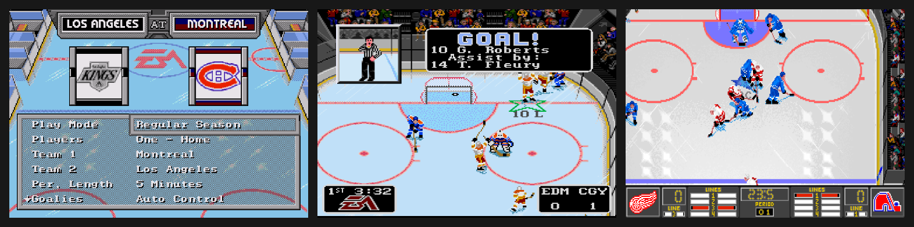

| A TV's 200 scanlines (15 kHz) | A VGA monitor's line doubling (31 kHz) |
| --- | --- |
| 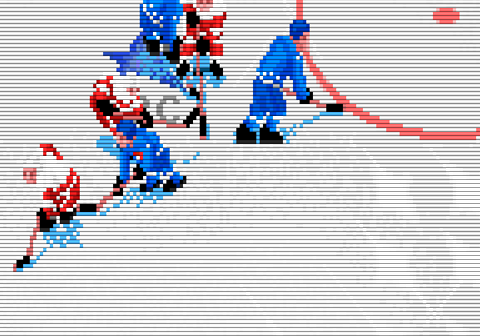 | 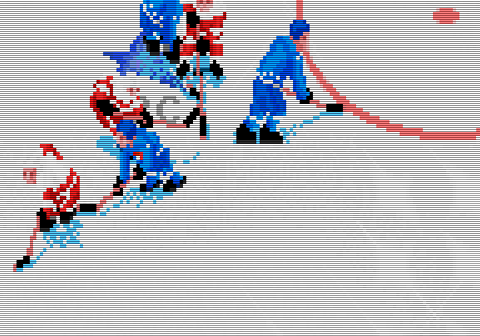 |

**Picture height** decides how the picture fits the window:

| Setting | What it does |
| --- | --- |
| **Fit** | As big as the window allows |
| **Integer** | A whole number of screen rows per game line, so scanlines stay even |
| **Overscan** | One step bigger than Integer, trimming a sliver off the top and bottom like a real TV |
| **Auto-crop** | Overscan when it only trims a few lines, otherwise Integer |

### 🖼️ Looks

Pick a **Scale Mode** in the **Scaling** menu. Only that mode's own options are listed under it.

| Look | What it gives you |
| --- | --- |
| **Sharp** | Crisp pixels at 2x to 9x, then smoothed to fit the window. 3x is the default |
| **CRT Monitor** | Light, medium or strong scanlines; a soft Lottes-style beam; soft with an aperture grille; or your own mix |
| **MiSTer** | The MiSTer FPGA scaler's filter files: Presets, horizontal and vertical filters, gamma and shadow masks, browsed by folder |
| **Scale2x, Scale3x, MMPX, xBR** | Pixel-art smoothing filters, where the port has them |

| Sharp | CRT medium | CRT soft |
| --- | --- | --- |
| 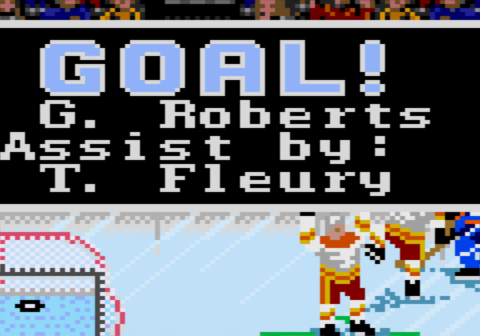 | 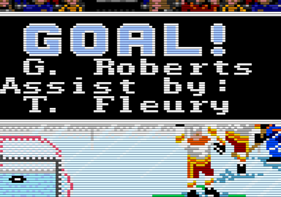 | 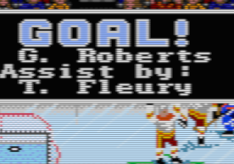 |
| **CRT soft + aperture grille** | **CRT custom** | **MiSTer + shadow mask** |
| 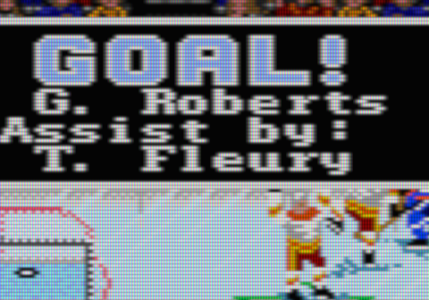 |  | 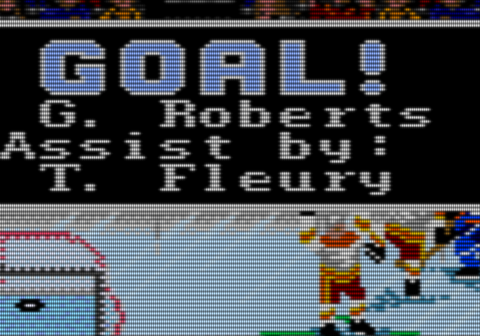 |

Each look is drawn at your window's own size, so the scanlines and masks land on whole screen pixels. With a GPU the looks run as shaders. Without one, Overbar draws them on the CPU, spread across all your cores.

The **custom** CRT look is set in the settings file: `*_custom_scanline_darkness` (0 to 1), `*_custom_gamma`, `*_custom_mask_strength` (0 to 0.3) and `*_custom_sharpness` (0 is soft, 1 is crisp).

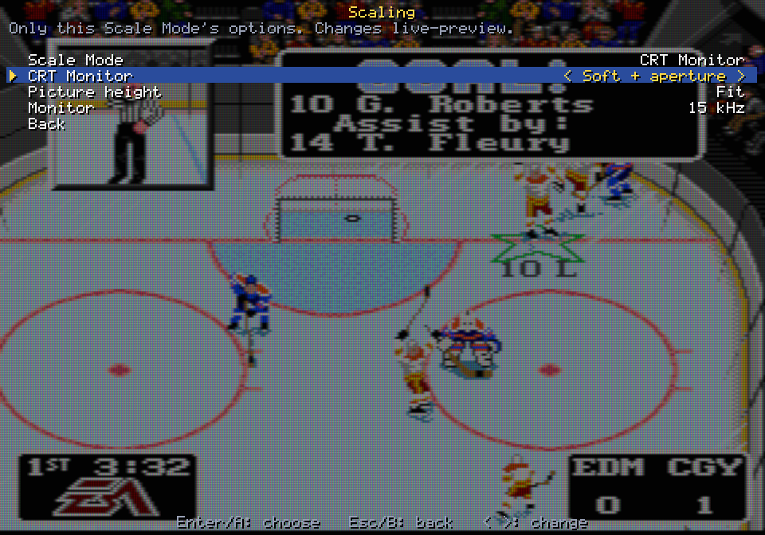

### 🕹️ MiSTer filters

Put the MiSTer `Filters`, `Gamma`, `Shadow_Masks` and `Presets` folders in a `mister` folder next to the game. The MiSTer pages list them the way the MiSTer does, and a check mark shows what's in use. A **Preset** sets all of them at once, and **Reset the MiSTer filters** goes back to the defaults (GS Sharpness 060, the adaptive SLA 030/070 scanlines and gamma 1.13).

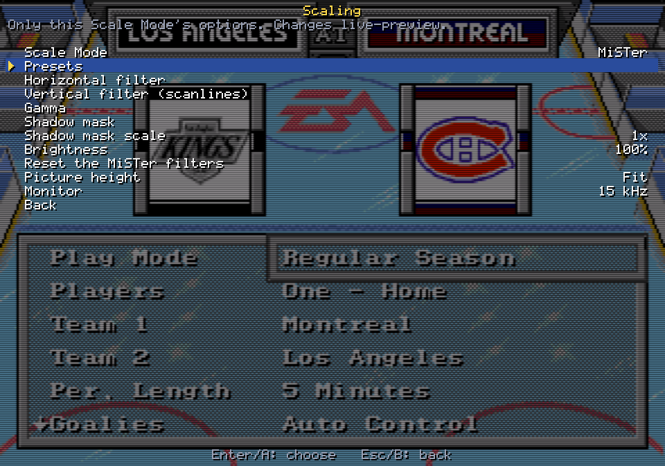

### ⏱️ Smooth play

- **Refresh** can be 60 Hz, 70 Hz or VRR (G-Sync and FreeSync). VRR is the default on a desktop.
- **Vsync** can be turned on or off.
- **F12** shows the frame rate and timing in a small box in the top right corner.

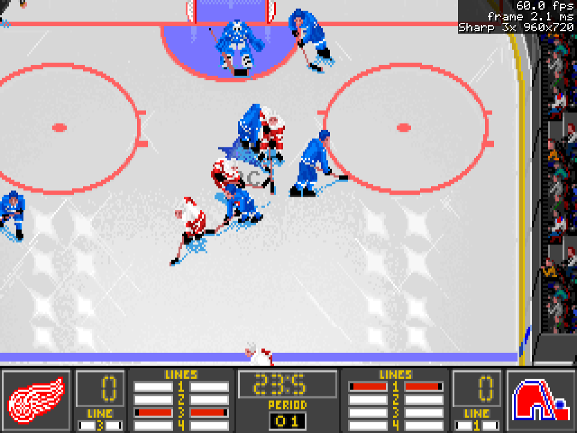

### 💾 Settings that stick

Everything you change is saved to an `.ini` file next to the game, which you can also edit by hand. The first time you run the game, Overbar writes sensible defaults to it.

### 📱 Handhelds

On PortMaster, Anbernic RG35XX and other KMSDRM devices, Overbar knows it's on a handheld. It starts at 60 Hz with vsync on and never needs desktop OpenGL. It skips the menu bar and uses only the overlay, which works with the controller.

### 🏒 Games using Overbar

| Port | Picture |
| --- | --- |
| [NHL '94 Genesis in C](https://github.com/abdulahmad/NHL94Genesis-C-Port) | 320x224 |
| [NHL '94 SNES in C](https://github.com/abdulahmad/NHL94SNES-C-Port) | 256x224 |
| [NHL 94 PC](https://github.com/abdulahmad/NHL94PC) | 320x200 |
| [NHL 95 PC](https://github.com/abdulahmad/NHL95PC) | 640x480 menus, 320x200 game |
| [NHL 96 PC](https://github.com/abdulahmad/NHL96PC) | 640x480 menus, 320x200 game |

---

## 🛠️ For developers: add Overbar to your own port

Overbar is plain C99 with no build system of its own to adopt. Your port compiles its source files with your own compiler and flags. It doesn't call SDL itself (apart from an optional helper), so it fits whatever window and renderer code your port already has.

### 1. 📦 Add it as a submodule

```sh
git submodule add https://github.com/abdulahmad/overbar.git third_party/overbar
```

Anyone cloning your port then runs `git clone --recurse-submodules`, or `git submodule update --init` in an existing clone.

### 2. 🔧 Compile it

**With Make:**

```make
include third_party/overbar/overbar.mk

# $(OVERBAR_SRCS): src/*.c       $(OVERBAR_PULSEMAN_SRC): PulseMan's menu renderer
# Both file names end in menu.c, so give the PulseMan object its own name.
CFLAGS += $(OVERBAR_INC) $(OVERBAR_DEFS)
```

**With a shell script:**

```sh
OVERBAR=$(tr -d '\r' < third_party/overbar/sources.txt | sed 's|^|third_party/overbar/|')
cc ... $OVERBAR -Ithird_party/overbar/include -DOB_SDL_BASE ... -lm
```

`-DOB_SDL_BASE` lets Overbar find the `mister` folder next to the program and draw the looks on several threads. Leave it out if you don't link SDL.

### 3. 🚀 Start it up

```c
#include "overbar/overbar.h"

static ob_host host;

ob_present_apply_hints(ob_profile_from_env());          /* before SDL_Init */
SDL_Init(SDL_INIT_VIDEO | SDL_INIT_GAMECONTROLLER);
ob_host_init(&host, OB_PORT_GENERIC,
             ob_profile_detect(SDL_GetCurrentVideoDriver(), ob_handheld_env()));
ob_host_load_ini(&host, "mygame.ini");                  /* writes defaults the first time */
ob_shell_set(&my_shell);                                /* see step 5 */
```

`OB_PORT_GENERIC` treats the picture as a console's: 224 or so lines shown with the pixel shape of a 240-line 4:3 TV. For a VGA game (320x200, 640x480) set `host.console_dar = 0` and the picture is plain 4:3.

### 4. 🖥️ Every frame

```c
ob_view_in in;
ob_view_out v;
const ob_look *look = &host.lores;
uint32_t *px;
int pw, ph;

/* where the picture goes in the window */
ob_view_from_host(&host, OB_CLASS_LORES, 320, 224, win_w, win_h, &in);
ob_view(&in, &v);

/* a CRT look or the MiSTer filters: drawn at the picture's size, ready to copy 1:1 */
if (ob_look_renders(look)
    && ob_look_render(look, frame, 320, 224, 320, v.blit_w, v.blit_h, &px, &pw, &ph)) {
    /* upload px (pw x ph, ARGB) and copy it to v.blit_x, v.blit_y, v.blit_w, v.blit_h */
} else {
    /* Sharp: nearest to a whole multiple, then smooth to the rect */
}

if (host.overlay_open) {
    /* fill a buffer about 0.8 of a game pixel per text pixel with 0x00040404, then: */
    ob_overlay_draw(&host, overlay_px, ow, oh, ow);
    /* blend it over the picture (pixels with alpha 0 are see-through) */
}
```

The NHL '94 SNES port's `platform/main.c` is a short, complete example, from the window and the overlay to the mouse and the stats box.

### 5. 🔌 Hooks and keys

Overbar calls your port back through an `ob_shell`. Every hook is optional:

| Hook | When Overbar calls it |
| --- | --- |
| `picture` | A video setting changed: re-read `host` and set up your renderer |
| `hold` | The menu opened (1) or closed (0): pause or resume the game |
| `redraw`, `draw_now` | The menu changed and the picture should be drawn again |
| `vsync`, `stats` | The player toggled them |
| `capture` | A Capture page action |
| `quit` | The player picked Quit |

Send keys and the controller to Overbar before the game sees them:

```c
if (ob_overlay_toggle_key(&host, scancode)) return;     /* ` and F11 */
if (ob_stats_toggle_key(&host, scancode)) return;       /* F12 */
if (host.overlay_open) ob_overlay_input(&host, MDRT_MENU_UP /* DOWN, LEFT, RIGHT, OK, BACK */);
```

The mouse works too: `ob_overlay_pointer` takes a position in the overlay buffer.

### 6. 🧩 Extras

- **Your own menu entries:** `ob_host_add_addon` adds a row to the main menu that calls your function.
- **Windows menu bar:** `ob_filemenu_init(hwnd)`, then `ob_filemenu_show(ob_filemenu_wanted(windowed, fullscreen, handheld))`. Pass the window's messages (SDL's `SDL_SYSWMEVENT`) to `ob_filemenu_event`.
- **Stats box:** `ob_stats_draw` draws three lines in a dark box, and `ob_stats_place` puts it in the top right corner.
- **Two picture sizes:** a game with a hi-res menu and a lo-res game screen (like NHL 95 PC) keeps a separate look for each, in `host.hires` and `host.lores`.

### 7. ✅ Check it

```sh
make test              # the tests, no SDL needed
sh tests/check.sh      # what CI runs: warnings as errors, 32 and 64 bit, the Windows cross compilers
make shots             # redraws the pictures in this README from docs/samples (needs Python with Pillow)
```

A plain build prints warnings without stopping, so a newer compiler still builds Overbar. CI is stricter and treats warnings as errors.

### 🔄 Updating Overbar in a port

Make the change here and push it. Then, in each port:

```sh
git -C third_party/overbar fetch && git -C third_party/overbar checkout <commit>
git add third_party/overbar && git commit -m "Overbar <commit>"
```

`.gitattributes` keeps every text file LF on every checkout, whatever `core.autocrlf` is set to.

### 🗂️ What's inside

```
include/overbar/overbar.h   the whole API
include/mdrt/menu.h         PulseMan's menu renderer
src/scaler.c                where the picture goes in the window
src/look.c                  the CRT looks and MiSTer filters in software
src/menu.c                  the menu pages, the MiSTer folders and filter files
src/overlay.c               the overlay, the stats box
src/filemenu.c              the Windows menu bar
src/host.c                  settings, defaults, the ini file
src/present.c               SDL_Renderer, GLES or OpenGL, and the handheld hints
third_party/pulseman/       PulseMan's menu renderer and font
tools/shots.c               the README's pictures
docs/samples/               the sample screens they are drawn from
tests/                      the tests
```

---

## 📜 Credits and derivative works

Overbar is a derivative of **[PulseMan](https://github.com/1nputs/pulseman) by 1nputs** (MIT License, Copyright (c) 2026 The pulseman authors). The files taken from PulseMan keep their original headers.

The rest is Copyright (c) 2026 abdulahmad and contributors, under the MIT License. See [LICENSE](LICENSE), [NOTICE](NOTICE) and [licenses/](licenses/).

The soft CRT look is after Timothy Lottes' CRT shader, and the MiSTer filter, gamma and shadow mask files are the MiSTer project's.

This project is the result of my work and the work of the people credited above. If you build anything from it, including mods, ROM or EXE hacks, ports, released forks, tools, or any other derivative work, you must credit us:

* Put the credit in your repo's README, near the top and not buried in a footer, and in the notes of every release you publish, including any text file shipped inside a release archive.
* Name me and link to this repository.
* Name everyone credited here: chaos, StaticEck, McMarkis (Mhopkinsinc) and Drezz, with special thanks to smozoma and kingraph.
* If you only use part of this repo (docs, a tool, labels, a file format description), the credit still applies.
* If you are unsure, over-credit.

Credit is the condition for using this work. Please do not release a derivative without it.
