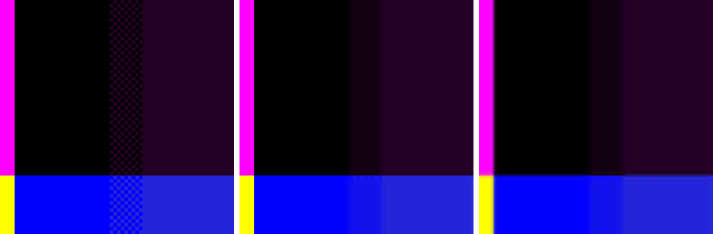

# Frame post-process: de-dither

`include/overbar/postfx.h` is a stage a port puts between its movie decoder and the screen. Consoles showed
full motion video with dithered colour: a checkerboard, one-in-four dots or stripes of two palette colours stand
for a colour between them. On a CRT the pattern blurred away. On a sharp screen it shows. The dither is part of
the stream, so the stage works on decoded frames. A port opts in per movie with `ob_postfx_run`, and nothing
else changes.

| Mode | What it does | Cost |
| --- | --- | --- |
| `off` | The decoder's frame, as the same pointer, so the pixels are identical. | none |
| `live` | Finds the dither's patterns and evens them out with a 3x3 binomial that does not reach across an edge. Every other pixel is left unchanged. | 0.8 ms for a 256x224 frame on a PC |
| `cached` | A better pass made once from the user's own disc and kept on their machine, never shipped: 2x up, a 1 2 2 2 1 low-pass over the dither, non-local means, a light sharpen, and smoothing over time. Until the cache is ready, the movie plays live. | about 50 ms a frame to make on a PC (one time, on a thread); 2.6 ms a frame to read |

Everything is integer arithmetic, so every machine produces the same pixels. `tests/test_postfx.c` checks this
with hashes of the outputs and of a cache file.

## Choices

- **The patterns.** A pixel counts as dither in two cases. One is a dot whose four sides are another colour. The other is a line in a period-two stripe whose colours differ by at most 96 in each channel. A pixel within one step of such a pixel is smoothed. The 1 2 1 binomial removes any period-two pattern exactly (one-in-four dots become 25% of the way, a checkerboard becomes halfway). A neighbour too far from the pixel is counted as the pixel itself, so edges stay where they are.
- **The cache's order** follows the spec: 2x up (pixel copies in the dither's zone, then the 1 2 2 2 1 low-pass, which has no response at periods 2 and 4 at 2x; bilinear elsewhere), then non-local means (5x5 search, 3x3 patches), then a sharpen of (c - blur) / 2, then a quarter of the last frame where a channel moved by 12 or less. A notch filter was tried before this work and left lines, which is why this pipeline is used.
- **The cache file** stores each frame as YCoCg, with the chroma at half size, a LOCO-I median prediction, near-lossless rounding (no sample is off by more than 1 before chroma averaging) and adaptive Rice codes. That is about 43 KB for a 512x448 frame of the test movie. The header records the movie's hash and size, so a cache made for another movie is not read. The cache is written to a `.part` file and renamed when it is done, so a half-made cache is never read.

## Before and after (a synthetic movie)

The same crop three times: the decoded frame (`off`), `live`, and `cached` (at 2x). Each one is a dithered
gradient next to a hard magenta edge.

The real intro is retail data. Shots of it stay on the user's machine and are not kept in this repository.
